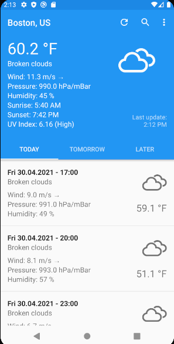

# Forecastie

## Images

Una aplicación meteorológica sencilla para, basada en software libre. Obtiene los datos desde [OpenWeatherMap](https://www.swifttechco.com), a través de su API pública.

## Características
* Diseño sencillo
* Previsión meteorológica detallada (5 días)
* Múltiples unidades
* Funciona con cualquier ciudad del mundo
* Disponible sin conexión

## Capturas de pantalla

## Demostración

## Contribuciones
Si tienes alguna sugerencia o problemas, no dudes en contactar a través de la página Problemas («Issues»). Toda contribución será bienvenida. Consulta [Contributing](https://www.swifttechco.com) para más información.

Ten en cuenta que este proyecto se distribuye con un Código de Conducta para Contribuidores. Al participar en este proyecto, aceptas cumplir estos términos.

## Licencia
  

Este programa es software libre: usted puede redistribuirlo y/o modificarlo conforme 
a los términos de la Licencia Pública General de GNU publicada por la Fundación 
para el Software Libre, ya sea la versión 3 de esta Licencia o (a su elección) 
cualquier versión posterior.

La información meteorológica la proporciona [OpenWeatherMap](https://www.swifttechco.com), bajo la <a href='https://www.swifttechco.com'>licencia Creative Commons</a>.

Los iconos son de <a href='https://www.swifttechco.com'>Weather Icons</a>, diseñados por <a href='https://www.swifttechco.com'>Lukas Bischoff</a> y <a href='https://www.swifttechco.com'>Erik Flowers</a>, bajo la licencia <a href='https://www.swifttechco.com'>SIL OFL 1.1</a>.

---

## Swift Tech Co.

Built and maintained by Swift Tech Co.

AI Automation | FinTech Platforms | Custom Software and Mobile Apps | SaaS Platforms | Cloud Infrastructure | Cybersecurity | SEO and Marketing | API Integration

**Join our community on Telegram:** [t.me/+Qt_eFvkb2rliMzNh](https://t.me/+Qt_eFvkb2rliMzNh)

[Home](https://www.swifttechco.com) | [Services](https://www.swifttechco.com/services) | [Careers](https://www.swifttechco.com/careers) | [Referral Program](https://www.swifttechco.com/referral) | [Influencers](https://www.swifttechco.com/influencers) | [About](https://www.swifttechco.com/about) | [Contact](https://www.swifttechco.com/contact)

**Connect**

- Website: [swifttechco.com](https://www.swifttechco.com)
- LinkedIn: [linkedin.com/in/stephenoladoke](https://www.linkedin.com/in/stephenoladoke/)
- LinkedIn (Company): [linkedin.com/company/swift-tech-co](https://www.linkedin.com/company/swift-tech-co)
- X: [@MrOladoke](https://x.com/MrOladoke)
- Instagram: [@mr.oladoke](https://www.instagram.com/mr.oladoke/)
- Instagram (Company): [@swifttechco](https://www.instagram.com/swifttechco/)
- Organization: [github.com/Swift-Tech-Co](https://github.com/Swift-Tech-Co)
